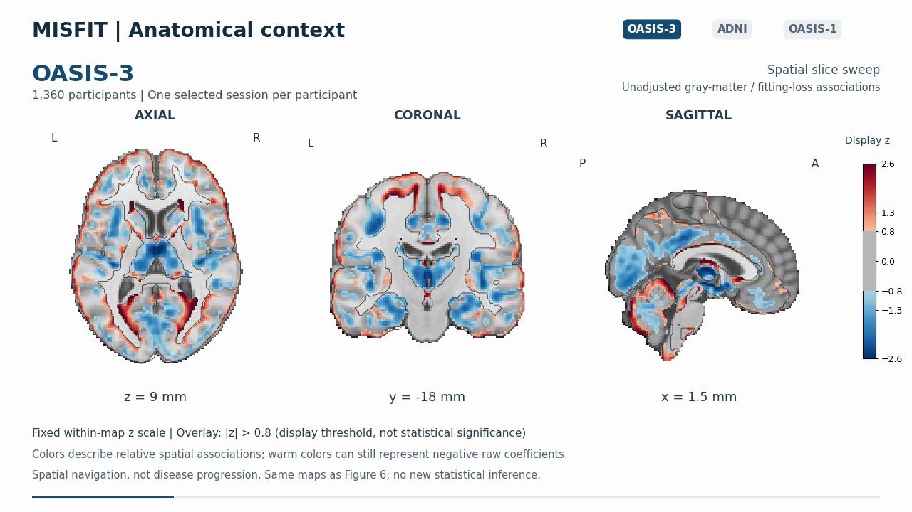

# MISFIT

### Revealing within-diagnosis failure patterns in MRI-based assessment of cognitive impairment

MISFIT characterizes fitting difficulty across training environments and relates those records to errors under imaging shifts. This repository contains the paper implementation in the **misfit** package, a **runnable synthetic-data example**, study protocols and an interactive brain-map explorer. Required training components and cohort loaders are included within that package.

Start with the synthetic example below. It runs on CPU and needs no original cohort data, archived predictions or downloaded models. Research results and pretrained models are not bundled; the existing HTML demo video and poster are the only included result media.

**Gang Qu · Guanghao Li · Zhengming Ding · Yipu Zhang · Xiaoqian Jiang · Zhongming Zhao**

[Quick start](#quick-start) · [How the example works](#how-the-example-works) · [Brain-map explorer](#brain-map-explorer) · [Optional manuscript replay](#optional-manuscript-replay) · [Citation](CITATION.cff)

## Quick start

Use Python 3.11 or newer. From the repository root:

~~~bash
python -m venv .venv
source .venv/bin/activate
python -m pip install -e ".[test]"
python -m misfit.demo --output results/synthetic_demo
~~~

On Windows, activate with `.venv\Scripts\activate`. The example selects CPU execution automatically; no CUDA setup is needed. Dependencies must be installed once, then the example runs without network access.

The command generates 180 samples across three environments and trains three refits with a short epoch budget. It prints held-out accuracy and failure-detection AUROC, then saves:

| File | Contents |
| --- | --- |
| `results/synthetic_demo/synthetic_scores.csv` | Generated features, labels, environments, MISFIT scores, held-out predictions and errors. |
| `results/synthetic_demo/summary.json` | Run settings, sample counts, overall accuracy and overall/within-label failure-detection AUROCs. |

These are synthetic demonstration outputs, not manuscript estimates. No patient data are used. Generated files are ignored by Git, and the command will not overwrite an existing run.

To try another seed or training budget, choose a new output directory:

~~~bash
python -m misfit.demo --seed 11 --epochs 40 --output results/synthetic_demo_seed11
python -m misfit.demo --help
~~~

## How the example works

1. Generate feature vectors and binary labels with feature shifts across three environments.
2. Hold out each environment in turn and fit the released model on the other two.
3. Assign each sample its mean training cross-entropy from the refits that include it: its MISFIT score.
4. Compare that score with the prediction error from the refit that excluded its environment.

The example uses the [existing collector](misfit/experiments/run_clinical_stratified_media.py) and fitting implementation, with a reduced training budget. Higher scores indicate greater fitting difficulty; the printed AUROC describes their relationship to errors in this toy run. Within-label AUROCs hold the generated class fixed. An AUROC is reported as null when its group contains only correct or only incorrect predictions.

The code is in [misfit/demo.py](misfit/demo.py). The [detailed guide](REPRODUCIBILITY.md#synthetic-example) explains the settings and outputs.

## Brain-map explorer

Explore axial, coronal and sagittal views of aggregate association maps from **OASIS-3, corrected ADNI and OASIS-1**. This separate HTML demo supports cohort selection, frame stepping, playback speed and full-screen inspection.

~~~bash
node docs/serve.cjs
~~~

Open **http://127.0.0.1:8766**. No Python environment or npm packages are needed for the viewer; `docs/index.html` can also be opened directly in a compatible browser. All viewer assets are bundled locally.

Select a cohort, drag the timeline or step through frames at 20 fps. The viewer shows spatial sweeps through aggregate maps on an MNI152 template; it does not expose individual scans or independent plane-coordinate selection. Display values are standardized within each map (limits ±2.6; threshold |z| > 0.8). The threshold is not statistical significance, warm colors can represent negative raw coefficients, and colors are not comparable effect sizes across cohorts. Media sources and hashes are recorded in [viewer provenance](docs/provenance.json).

For later GitHub Pages hosting, use the main branch's /docs folder. No deployment has been performed.

## Optional manuscript replay

Exact reproduction of published numerical results is a separate, optional workflow. It requires authorized cohort inputs and, for the historical CNN replay commands, the original hash-verified score/prediction arrays. These files are **not needed for the synthetic example or HTML demo** and are not distributed here.

The [optional reproduction guide](REPRODUCIBILITY.md) collects the manuscript-to-code map, input requirements, analysis commands, rank-transfer workflows and implementation notes.

## Software checks

~~~bash
python -m pytest
node --test docs/tests/*.test.cjs
~~~

The Python suite includes an end-to-end synthetic run, repeatability, score/error consistency, input validation and overwrite protection. Other tests cover participant separation, preprocessing, gradients, curvature, calibration and bootstrap behavior. Tests requiring authorized cohort data are excluded by default.

## Repository structure

~~~text
misfit/
  demo.py                  Runnable synthetic-data example
  experiments/             Canonical scoring, comparators and paper experiments
  manuscript_analysis/     Clinical and conditional statistical analyses
  correction_20261018/      Participant-purged ADNI analyses
  rank_validation/         Rank-transfer validation
  crt_study/               Auxiliary CNN curvature study
  ortho_views/             Anatomical-map rendering
  core/, training/         Required model and training components
  data/, tensor_spectral/  Cohort loaders and spectral diagnostics
  certificates/            PAC-Bayes comparator
  paths.py                 Portable input and output paths
docs/                      HTML explorer and demo media
tests/                     Synthetic integration and numerical checks
provenance/                Source manifests and study protocols
~~~

## Citation and license

The manuscript title and author list are provided in [CITATION.cff](CITATION.cff). Publication identifiers will be added when available.

Project code is released under the [MIT License](LICENSE). Third-party dataset and anatomical-template terms continue to apply to their data and derived media.
